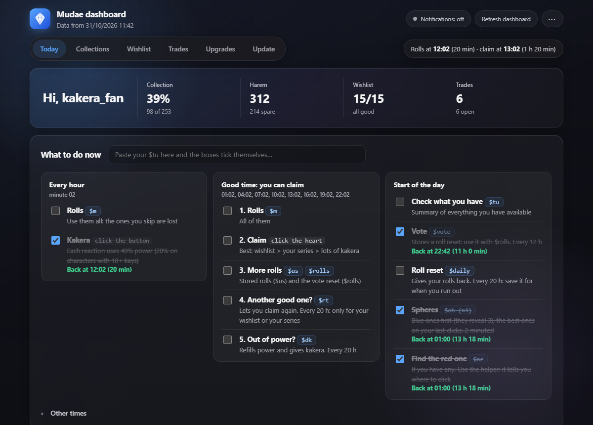
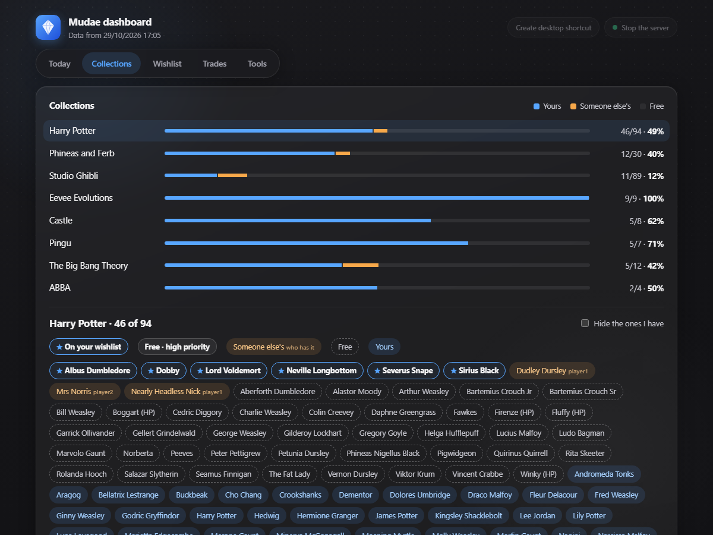
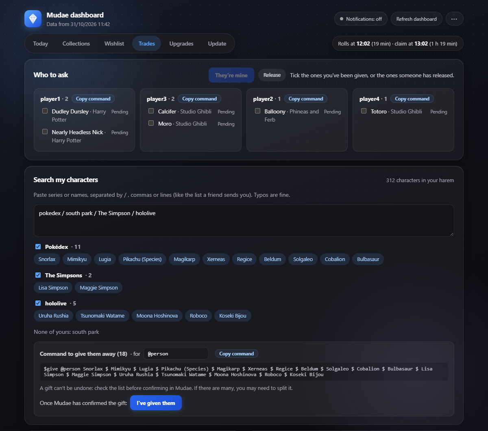

<p align="center"></p>

<h1 align="center">Mudae Dashboard</h1>

<p align="center">Keep your <a href="https://mudae.net">Mudae</a> collections up to date without missing a roll.<br>
<b>Download:</b> green <b>Code → Download ZIP</b> button at the top of this page.<br>
<b>English</b> · <a href="README.ca.md">Català</a> · <a href="README.es.md">Español</a></p>



A dashboard that runs on your own computer for the Mudae Discord bot. You paste what Mudae sends you and it tracks your collections, wishlist and trades, tells you what to do each hour, helps you with the `$oc` sphere game and keeps an Excel workbook up to date. Available in English, Catalan and Spanish.

## Features

- **What to do now**: a clock for rolls and claims, and a checklist where each task stays ticked until you can do it again (`$daily` and `$dk` every 20 h, `$vote` every 12 h, `$oh` at midnight UTC, rolls every hour…).
- **`$oc` helper**: mark the colors that appear and it tells you which square to click to find the red sphere.
- **Collections**: one album per series with your characters, the free ones, the ones on your wishlist and the ones other players own (and who). Click the ones you get to mark them as yours.
- **Custom collections**: a group you pick, even if it isn't a Mudae series (for example, the Eevees from the Pokédex). Type its name and characters, and the `$imaso` of the series they come from fills in who owns each one.
- **Upgrades**: paste your `$k`, `$kt` or `$opp <character>` and it tells you which badge, tower floor and sphere perk to get next, and how much kakera you still need.
- **Wishlist**: warns you about characters you already own or someone else claimed, and builds the `$wishremove` and `$wish` commands for you.
- **Trades and gifts**: the `$give` command for each player, and a search box that understands misspelled series lists («full metal alchimist», «Rezero»…).
- **Update**: paste your `$mms`, `$wl` or `$imaso` and click a button. It reminds you if your harem is more than a week old.
- **Common commands**: all of them, with what they do and a copy button.
- **Excel**: the same in a spreadsheet, which keeps what you type in it (priorities, notes, trade status).

| Collections | Search for gifts |
|---|---|
|  |  |

## Install (5 minutes)

1. Install [Python](https://www.python.org/downloads/) 3.12 or newer. On the first screen of the installer, **tick «Add python.exe to PATH»**.
2. Click the green **Code → Download ZIP** button at the top of this page and unzip the folder somewhere you'll keep it (for example, Documents). Don't run it from inside the zip.
3. Double-click **`Configura.bat`**. Choose your language (English by default), then type your Mudae name (the one in «Belongs to …» on your characters) and, if you want, your server's name. It creates a **Mudae** shortcut on your desktop and opens the dashboard.
4. In the dashboard, go to **«Update»** and paste, in this order:
   - **Your harem**: type `$mms` in Discord, copy the message Mudae sends you by DM and paste it choosing «Your harem».
   - **Your wishlist**: `$wl`, choosing «Your wishlist».
   - **Each series you collect**: `$imaso <series>` (for example `$imaso Harry Potter`), choosing «A series» → «New series…» and typing its name as Mudae shows it.

From then on, open the dashboard with the **Mudae** shortcut on your desktop.

## Every day

- **What to do now** tells you what to do and when. Tick things as you do them.
- **When you get a character**: in «Collections», choose the series, click it and click **They're mine**.
- **When you give characters away**: in «Search my characters», find them, copy the `$give` command and, once Mudae confirms it, click **I've given them**.
- **Once a week**: paste your `$mms` again in «Update» (the dashboard reminds you).

## Good to know

- **Close the Excel file** before using the dashboard buttons: it can't be saved while it's open.
- The buttons use a small server that only listens on your own computer (`127.0.0.1`) and only accepts requests from the dashboard. It stops by itself a couple of minutes after you close the tab, or with the **Stop the server** button.
- You can paste messages as they are: Discord headers, «Page 1 / 21» and numbering are ignored.
- **Don't delete the `lib` folder**: it has what the program needs to write the Excel file.

## Your data

The dashboard doesn't connect to Discord or Mudae and doesn't need an account. It only reads what you paste and saves it in the `dades/` folder on your computer.

## Settings (`dades/config.json`)

| Key | What it is |
|---|---|
| `usuari` | Your Mudae name. Set by `Configura.bat`. |
| `idioma` | `en`, `es` or `ca`. Run `Configura.bat` again to change it. |
| `servidor` | Optional: shown in the dashboard and Excel titles. |
| `discord_id` | Optional: the number `$myid` gives you, so the `$give` commands you copy mention you properly. |
| `hores_reclam` | Optional: the hours when you can claim on your server. Default `[1, 4, 7, 10, 13, 16, 19, 22]` (every 3 hours, at minute 02). |
| `rt_hores` | Optional: how often you can use `$rt`. Default `50`; take off 10 hours for each Emerald II, III and IV badge (`20` with all three). |
| `preferits` | Optional: characters the dashboard suggests first when a wishlist slot frees up, for example `["Fawkes", "Howl"]`. |

## Troubleshooting

- **«Could not update»**: close the Excel file and open Mudae again.
- **A button says «No connection» or «Button off»**: open the dashboard with the Mudae shortcut, not by opening `dashboard.html` directly.
- **«Python 3.12 or newer is needed»** when opening `Configura.bat`: install Python (step 1) and try again.

## How it's built

- `mudae.py`: the whole program, using the Python standard library and openpyxl. Reads `dades/`, writes the Excel file and `dashboard.html`, and runs the local server.
- `i18n.py`: Spanish and English texts (the Catalan text is the key).
- `oc.html`: the `$oc` helper, with no dependencies.
- `lib/`: openpyxl and et_xmlfile, bundled so it works without `pip install`.
- `Configura.bat` / `Actualitza.bat`: first-time setup and the desktop shortcut.

Tests:

```bash
python -m unittest discover tests
node tests/test_oc.mjs
node tests/test_rutina.mjs
node tests/test_millores.mjs
```

Missing translations: `python tools/textos.py`. Clean zip to share (no personal data): `python tools/fer_zip.py`.

## License

[MIT](LICENSE) © 2026 Victor Lara (Vlarac).

Fan project: not affiliated with or endorsed by Mudae or Discord.

<p align="center"><sub>Developed by <a href="https://github.com/Vlarac03">Vlarac</a></sub></p>
